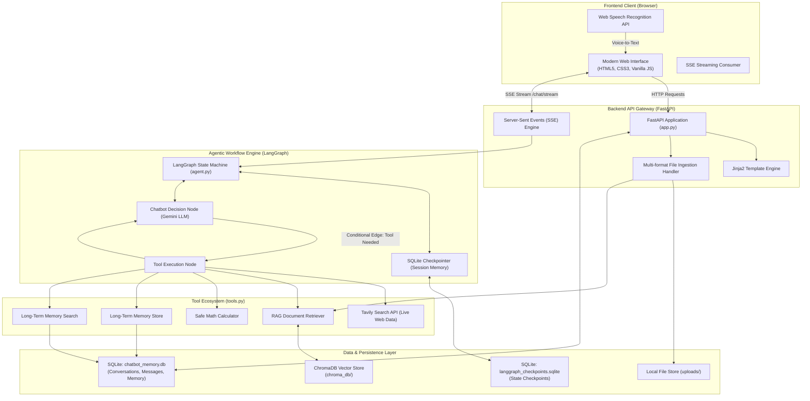
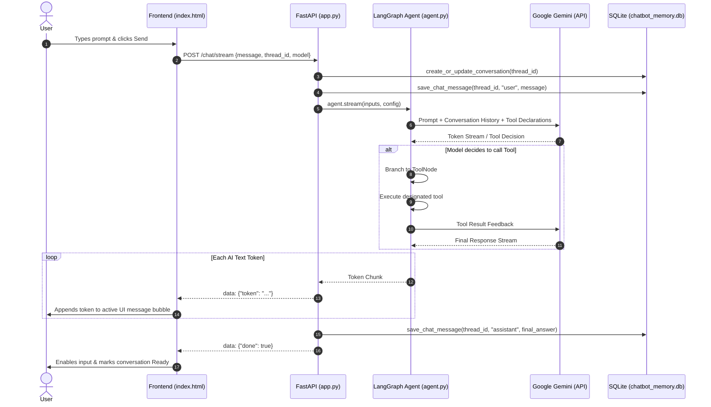
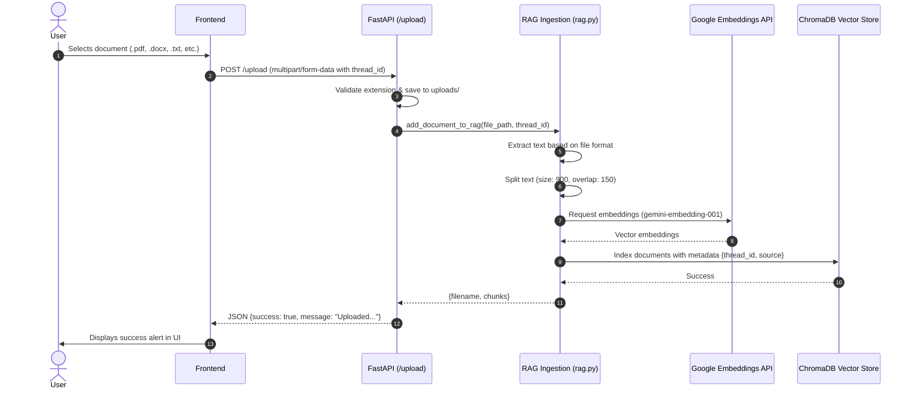
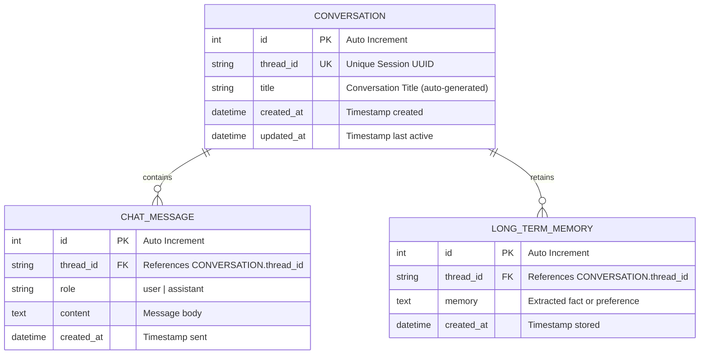

# BittuGPT - System Design & Architecture Document

This document provides a comprehensive technical overview of the system design, architecture, data flow, component interactions, and infrastructure for **BittuGPT** — an autonomous, agentic AI assistant application.

---

## 1. High-Level Architecture

BittuGPT is designed around an **Event-Driven, Agentic Loop Architecture** using **FastAPI**, **LangGraph**, **LangChain**, **Google Gemini**, **ChromaDB**, and **SQLite**.

---

## 2. Core Architectural Components

### 2.1 Presentation & Client Layer (`templates/index.html`)
- **Technology**: Vanilla HTML5, CSS3 (Custom Dark Theme with Inter typography), Pure ES6+ JavaScript.
- **Responsibilities**:
  - Render a responsive ChatGPT-style interface with a collapsible sidebar and multi-session view.
  - Establish a persistent connection with `/chat/stream` using the **Fetch API & ReadableStream** to handle Server-Sent Events (SSE).
  - Provide multi-format document drag-and-drop & file picker (`.pdf`, `.docx`, `.txt`, `.md`, `.py`, `.csv`).
  - Native browser speech-to-text dictation using the `webkitSpeechRecognition` / `SpeechRecognition` API.
  - Dynamically switch between Google Gemini models (`gemini-2.5-flash`, `gemini-2.5-pro`, `gemini-1.5-flash`, etc.).

### 2.2 Application & API Gateway (`app.py`)
- **Technology**: FastAPI (ASGI), Uvicorn.
- **Key Responsibilities**:
  - Serves static HTML and templated frontend.
  - Exposes RESTful endpoints for session management (`/conversations`, `/history/{thread_id}`).
  - Manages file ingestion via `/upload`.
  - Streams real-time tokens via `/chat/stream` using asynchronous generators (`StreamingResponse`).
  - Filters internal tool execution messages, JSON schemas, and invalid calls to provide clean AI prose to the frontend.

### 2.3 Agentic Orchestration Layer (`agent.py`)
- **Technology**: LangGraph (`StateGraph`, `MessagesState`, `ToolNode`, `tools_condition`), LangChain Google GenAI (`ChatGoogleGenerativeAI`).
- **Design Pattern**: **ReAct (Reasoning + Acting) Agent Pattern**.
- **Execution Flow**:
  1. The agent receives incoming messages along with conversational history reconstructed from the checkpointer.
  2. The LLM evaluates user intent against available tools (`calculator`, `search_uploaded_documents`, `remember_this`, `recall_memory`, `web_search`).
  3. If tool calls are requested, control branches dynamically via `tools_condition` to `ToolNode`.
  4. The tool executes and returns a `ToolMessage` back to the `chatbot` node.
  5. The model synthesizes the tool result and generates a final streaming response to the user.
  6. State transitions are persistently checkpointed to `langgraph_checkpoints.sqlite`.

### 2.4 Retrieval-Augmented Generation (RAG) Subsystem (`rag.py`)
- **Technology**: ChromaDB (Vector Store), Google Generative AI Embeddings (`gemini-embedding-001`), LangChain Text Splitters, PyPDF, python-docx.
- **Pipeline**:
  - **Extraction**: Reads raw text from multi-format files.
  - **Chunking**: Splits documents into chunks using `RecursiveCharacterTextSplitter` (chunk size: 900, overlap: 150).
  - **Embedding**: Generates dense vector representations using Gemini embeddings.
  - **Indexing**: Stores vectors in ChromaDB with metadata filtering based on `thread_id`.
  - **Retrieval**: Performs semantic similarity search (Top-k = 4) isolated by session context.

### 2.5 Persistence & Memory Layer (`database.py`)
- **Technology**: SQLAlchemy ORM, SQLite.
- **Databases**:
  1. `chatbot_memory.db`: Stores structured application metadata:
     - `conversations`: Thread registry, auto-generated title, and timestamps.
     - `chat_messages`: Canonical chat logs (`role`: user / assistant).
     - `long_term_memory`: User facts, preferences, and custom context explicitly saved via the `remember_this` tool.
  2. `langgraph_checkpoints.sqlite`: Manages LangGraph state snapshots, message graphs, and multi-turn state resumption.

---

## 3. Sequence & Data Flow Diagrams

### 3.1 Chat Execution & Streaming Flow (SSE)

### 3.2 Document Upload & RAG Indexing Flow

---

## 4. Database Schema Design

### 4.1 Relational Schema (`chatbot_memory.db`)

### 4.2 Vector Store Schema (`chroma_db`)
- **Collection Name**: `agentic_chatbot_docs`
- **Embedding Dimensions**: 768 (standard Gemini embedding dimension)
- **Document Payload**:
  - `page_content`: Chunked text segment (<= 900 characters).
  - `metadata`:
    - `thread_id`: String UUID isolating search per conversation.
    - `source`: Original file name.

---

## 5. Deployment Architecture & CI/CD

BittuGPT features a production-ready CI/CD pipeline using **Docker**, **AWS ECR**, **AWS EC2**, and **GitHub Actions**.

```mermaid
graph LR
    subgraph Development["Local Dev / GitHub"]
        Repo["GitHub Repository\n(entbappy/BittuGPT)"]
        Push["git push origin main"]
    end

    subgraph CI["Continuous Integration (GitHub Runner)"]
        Actions["GitHub Actions (cicd.yaml)"]
        BuildDocker["docker build -t bittugpt"]
        LoginECR["Login to AWS ECR"]
        PushECR["docker push to Amazon ECR"]
    end

    subgraph CD["Continuous Deployment (Self-Hosted Runner on EC2)"]
        PullECR["docker pull latest image from ECR"]
        StopOld["docker stop agentic-chatbot"]
        RunNew["docker run -d -p 8080:8080 --env-file"]
        Prune["docker image prune -f"]
    end

    Push --> Repo
    Repo --> Actions
    Actions --> BuildDocker
    BuildDocker --> LoginECR
    LoginECR --> PushECR
    PushECR --> PullECR
    PullECR --> StopOld
    StopOld --> RunNew
    RunNew --> Prune
```

---

## 6. Security & Operational Considerations

1. **API Key Isolation**:
   - Secrets are loaded dynamically via `python-dotenv` from `.env`.
   - `.env`, `data/`, and `chroma_db/` are strictly ignored by `.gitignore` to prevent secret leakage.
2. **Safe Code & Math Evaluation**:
   - The `calculator` tool executes expressions inside a sandboxed namespace with `__builtins__` stripped out, allowing only mathematical functions (`abs`, `round`, `min`, `max`, `sum`, `math.*`).
3. **Session Isolation**:
   - RAG document searches and memory retrieval are filtered strictly by `thread_id`, ensuring cross-tenant privacy between conversations.
4. **Stream Resilience**:
   - The SSE stream incorporates structured error handling (`{"error": "..."}`) ensuring client UI states never stay stuck in loading mode if a timeout or API limit occurs.
